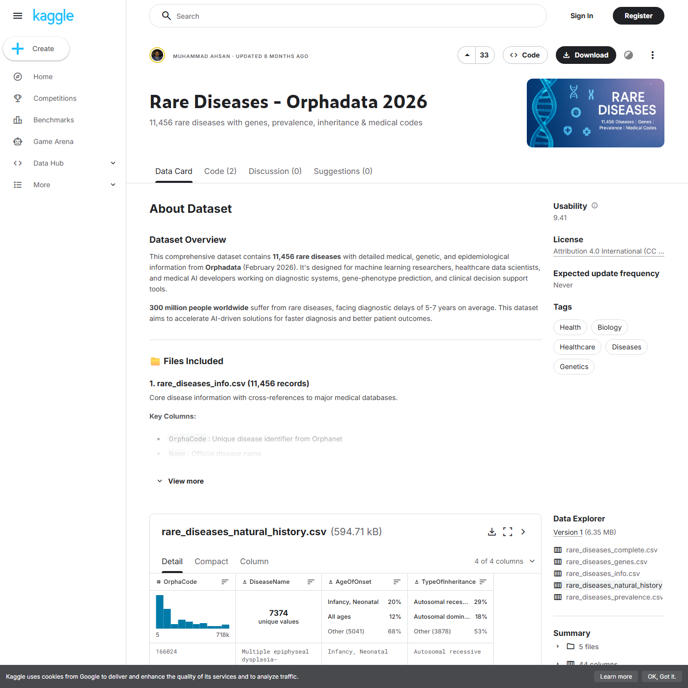
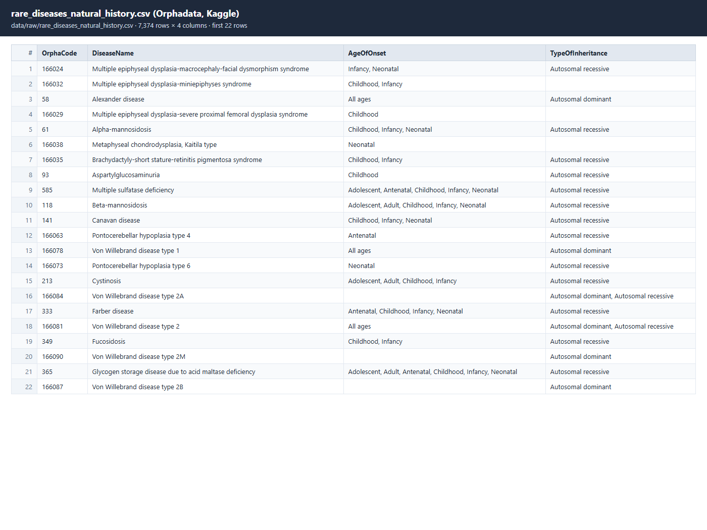
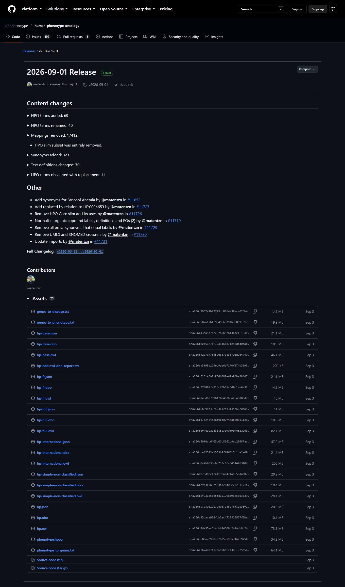
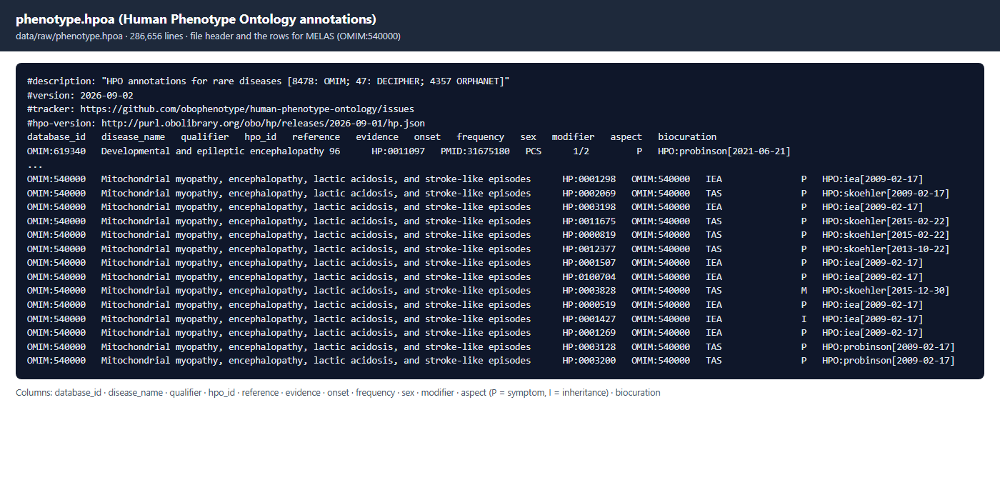
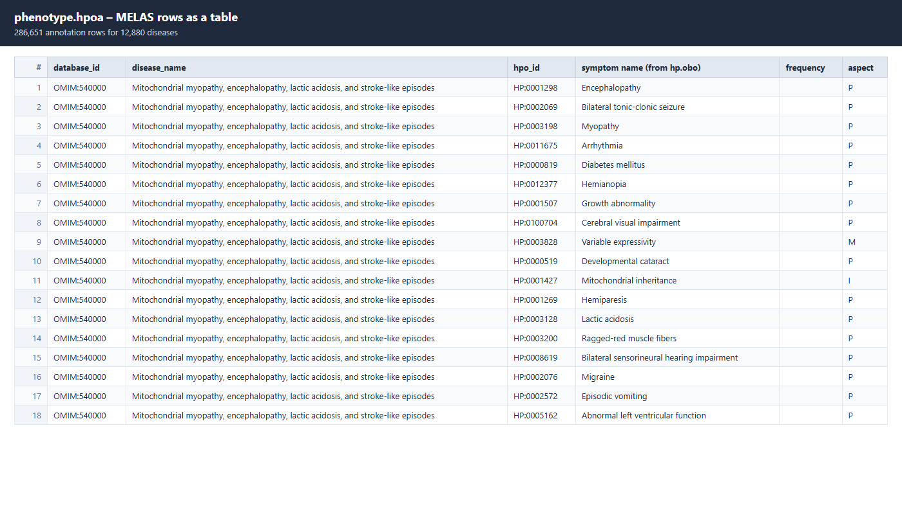
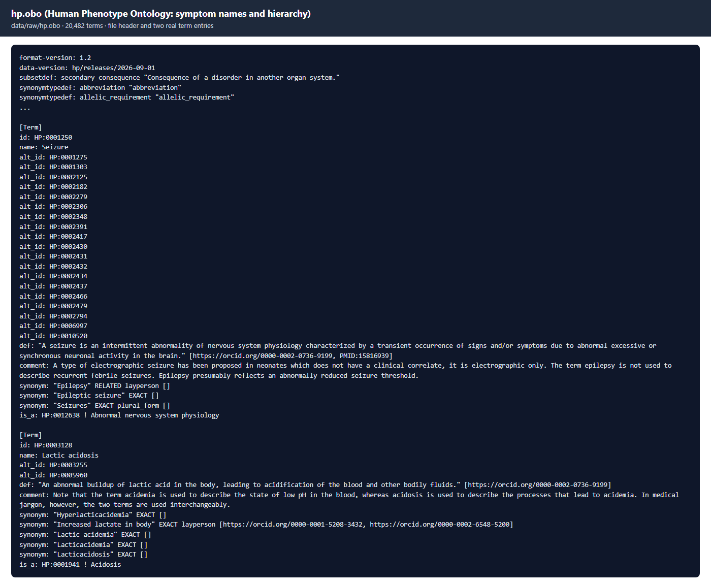
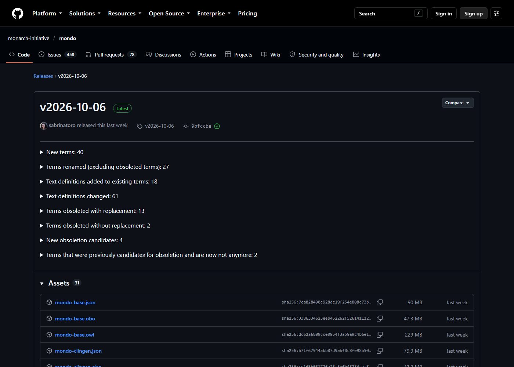
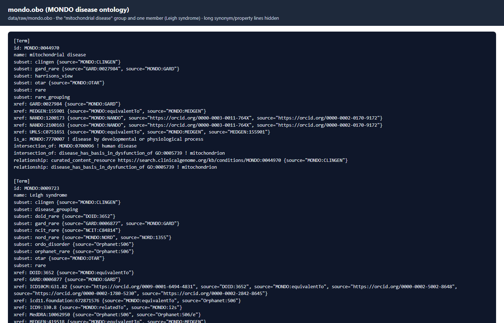
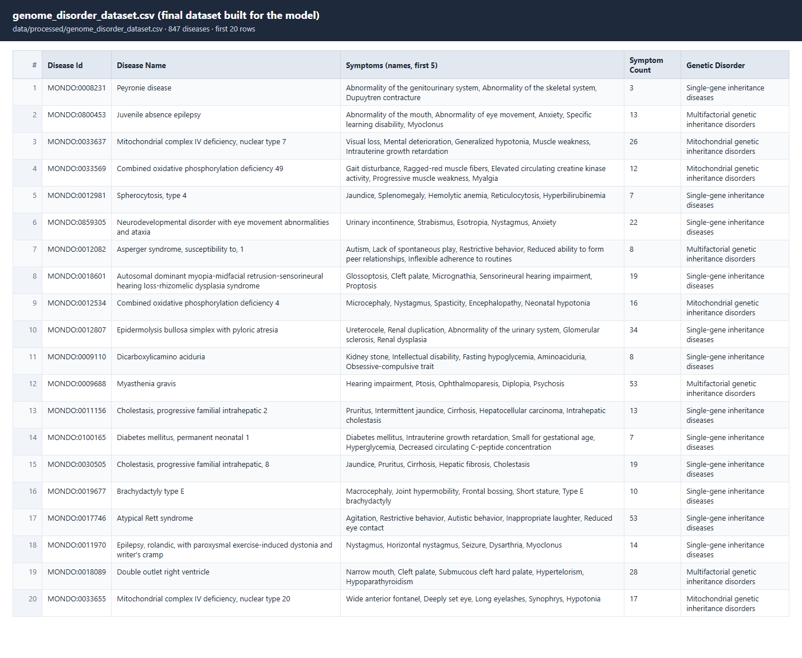
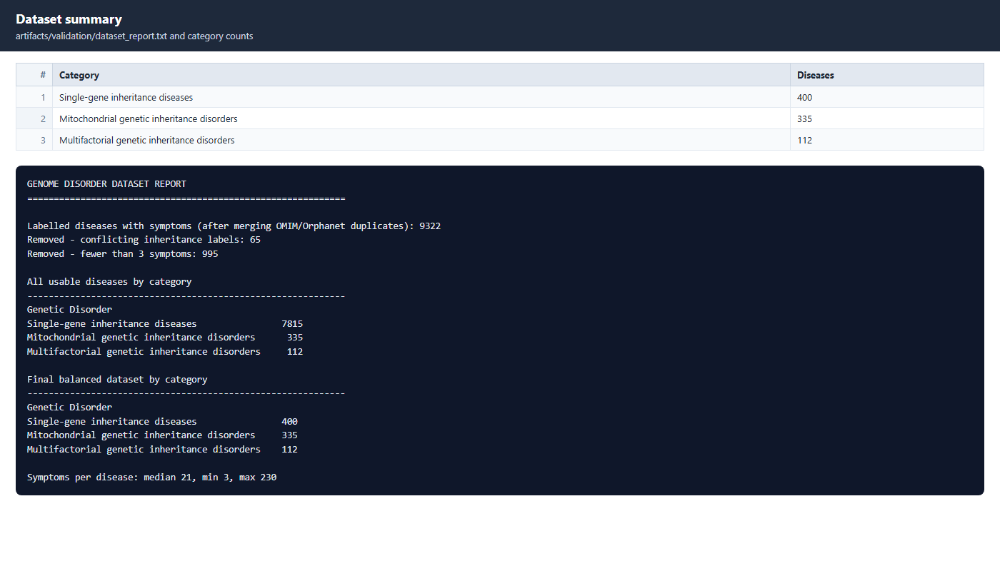

# V4 Datasets Used

## 1. Orphadata (Kaggle): inheritance type of each rare disease

Source: https://www.kaggle.com/datasets/ahsanneural/rare-diseases-orphadata-2026

First rows of `rare_diseases_natural_history.csv`:

## 2. Human Phenotype Ontology: symptoms of each disease

Source: https://github.com/obophenotype/human-phenotype-ontology/releases/latest/download/phenotype.hpoa

Rows of `phenotype.hpoa` (example disease: MELAS):

## 3. Human Phenotype Ontology: symptom names

Source: https://github.com/obophenotype/human-phenotype-ontology/releases/latest/download/hp.obo

## 4. MONDO disease ontology: mitochondrial disease group

Source: https://github.com/monarch-initiative/mondo/releases/latest/download/mondo.obo

## 5. Final dataset used to train the model

